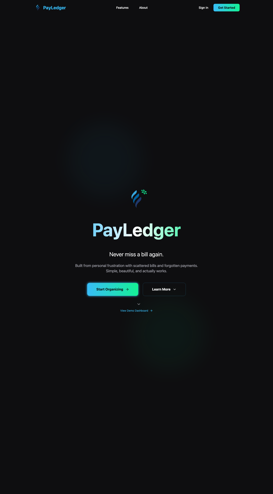
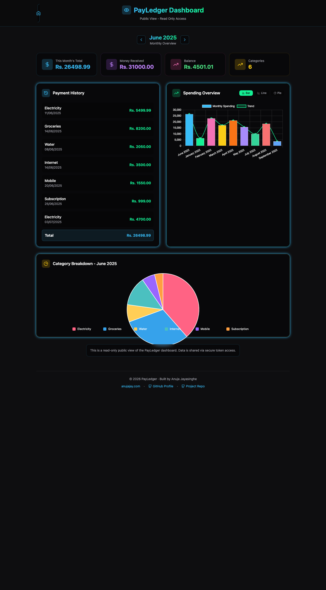
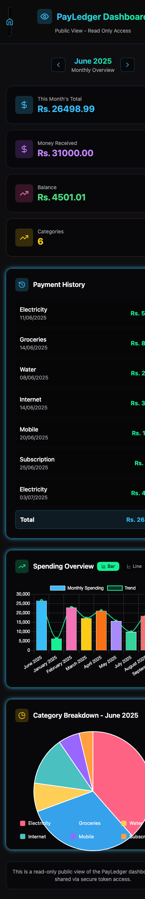

# PayLedger

> [!NOTE]
> **PayLedger has graduated. 🎓** (November 2026)
> This isn't the end of the idea — it's moving to a bigger home. Everything PayLedger set out to do (bills, payments, monthly clarity) is being carried into my upcoming all-in-one personal platform *(name coming soon)*, alongside vehicles, utilities and more.
> This repository stays here, read-only, as the place it all started. The live site at `payledger.anujajay.com` has been retired.

**PayLedger** is a web app that helps users track bills, manage finances, visualize monthly spending, and share public dashboards securely. Built with Next.js, Supabase, and Tailwind CSS, it offers email summaries, charts, and real-time insights—all in a responsive neon-glassy UI.



| Dashboard | On a phone |
|---|---|
|  |  |

<sub>Screenshots of the public demo dashboard, captured on the day the project was archived.</sub>

---

## 📌 Overview

PayLedger was born out of a personal frustration: juggling bills, subscriptions, and expenses across spreadsheets and sticky notes. This finance tracker solves that chaos with a sleek, all-in-one dashboard. Built for individuals who want clarity in their cash flow, it turns messy finances into actionable insights—with neon-glassy aesthetics for a touch of fun.

> "Why stress over bills when PayLedger organizes, visualizes, and even reminds you?"

## 🗓 Project timeline

| When | What |
|---|---|
| 15 Jun 2025 | First commit |
| 16–23 Jun 2025 | Built in 9 days — Google login, bill manager, dashboard, charts, public share links, email summaries (PRs #1–#28) |
| Jun 2025 – Apr 2026 | In daily use for tracking real bills |
| Jan 2026 | Last code change: React Server Components CVE fix (PR #29) |
| Nov 2026 | Graduated: data safely archived, live site retired, ideas carried into a bigger platform |

## 📚 Tech Stack

| Category      | Tech Used                             |
| ------------- | ------------------------------------- |
| Framework     | [Next.js 14](https://nextjs.org/) (pages router) |
| Language      | TypeScript                            |
| Styling       | Tailwind CSS                          |
| Backend       | [Supabase](https://supabase.com/) (Postgres + Google sign-in) |
| Email Service | [EmailJS](https://www.emailjs.com/)   |
| Charts        | Chart.js + React-ChartJS-2            |
| Icons         | lucide-react                          |
| Hosting       | Vercel                                |

---

## ✨ Features

* 🔐 **User Authentication** with Supabase (Google sign-in)
* 📊 **Dashboard** for monthly financial overviews
* 📧 **Email Summaries** of bills and income
* 📅 **Bill Manager** to track and edit bills
* 🌐 **Public Dashboards** via secure token links
* 📊 **Interactive Charts** (Bar, Pie, Line)
* 🚀 **Responsive Neon-Glassy UI**

---

## 📁 Project Structure

```
.
├── pages/              # All route pages (index, dashboard, login, etc.)
├── components/         # Reusable React components
├── lib/                # Supabase client
├── public/             # Static assets
├── styles/             # Global styles
├── package.json        # Project metadata and scripts
└── tsconfig.json       # TypeScript configuration
```

## 📌 Pages Overview

| Page                | Description                       |
| ------------------- | --------------------------------- |
| `/`                 | Home page / Landing               |
| `/login`            | User authentication               |
| `/dashboard`        | Private dashboard after login     |
| `/public-dashboard` | Publicly sharable dashboard (via tokens) |
| `/billManager`      | Bill creation and editing         |
| `/emailSummary`     | Email summary preview and sending |
| `/about`            | Project details                   |

---

## 🧠 What I learned

Looking back at this project while archiving it:

* **Turn Row Level Security on, not just write policies.** Policies only apply when RLS is enabled on the table — check every table.
* **Keep config in environment variables**, not in source files, even for "public" keys.
* **Commit the database schema** as migrations, so the repo alone can rebuild the app.
* **Send email from the server**, not the browser, so service IDs and keys stay private.
* **Small PRs as save points** made a fast 9-day build easy to follow, even a year later.

---

## 🛠 Running it locally (for reference)

The hosted backend no longer exists. To run the code you would need your own Supabase project with matching tables, and to point `lib/supabaseClient.ts` at it.

* `npm install`
* `npm run dev` — Start dev server
* `npm run build` — Create production build

---

## 🚀 What's next

PayLedger proved the idea worked — tracking bills in one place genuinely helped. Its next chapter is a single personal platform that brings bills and subscriptions together with everything else that needs remembering: vehicle renewals, utility readings, reminders. Lessons from here (above) are baked in from day one.

---

## 📄 License

[MIT](LICENSE) © 2025 Anuja Jayasinghe — feel free to learn from or reuse any of this code.

---

## 👤 Author

* Developed by **Anuja Jayasinghe**
  🌐 [anujajay.com](https://anujajay.com)

  [](https://linkedin.com/in/anujajayasinghe) [](https://github.com/Anuja-jayasinghe)

---

> Crafted by Anuja Jayasinghe after one too many late-night **bill-scrambling** sessions. Thank you to everyone who starred, tried the demo, or gave feedback. ⭐
